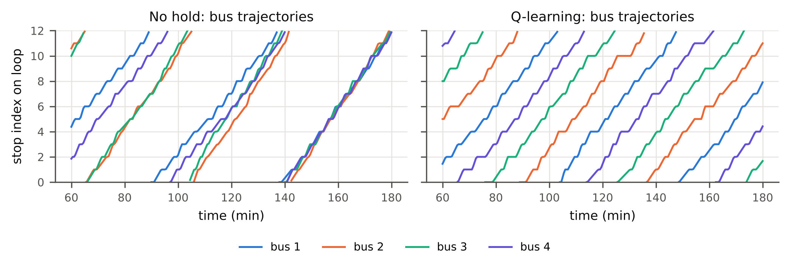

# Bus Holding Control with Q-Learning (Bus Bunching on a Loop Route)

**Author:** Faiz Imdad (B23CM1016) — AI Assignment 2, Real-Life Use Cases of RL

Buses on a high-frequency loop route tend to *bunch*: a bus that falls slightly
behind finds more waiting passengers, dwells longer, falls further behind, while
the bus behind it catches up. Passengers then see buses arriving in clumps followed
by long gaps. This project trains a **tabular Q-learning agent** that decides, at
every stop, whether to **hold the bus for 0, 2 or 4 minutes** to keep buses evenly
spaced, and compares it against a no-holding policy and two rule-based controllers.



## Results (100 held-out test episodes, 4 buses, 12 stops)

| Controller | Avg wait (min) | Hold delay/pax (min) | **Total cost/pax (min)** | Headway CV | Bunched arrivals (%) |
|---|---|---|---|---|---|
| No holding | 12.16 | 0.00 | 12.16 | 1.175 | 46.0 |
| Forward-headway rule | 8.13 | 1.43 | 9.56 | 0.593 | 0.0 |
| Two-way (even-headway) rule | 5.90 | 1.23 | 7.14 | 0.401 | 2.2 |
| **Q-learning (ours)** | **4.91** | 1.68 | **6.59** | **0.147** | **0.0** |

*Total cost = passenger waiting time at stops + delay imposed on on-board passengers
by holding.* The Q-learning policy lowers total passenger cost by 46% versus
no holding and by 8% versus the strongest rule-based controller, and makes
headways 2.7× more regular. See `results/metrics_table.md` (with standard
deviations) and `results/figures/` for all plots.

## Repository layout

```
busrl/
  env.py         loop-route simulator (stochastic run times, Poisson demand, dwell model)
  agent.py       tabular Q-learning agent, state discretisation, reward
  baselines.py   no-holding, forward-headway threshold rule, two-way rule
train.py         trains the agent  -> results/q_table.npz, results/training_log.csv
evaluate.py      tests all controllers on held-out seeds -> results/metrics.json, sensitivity.json
ablation.py      training-seed robustness + holding-cost-weight sweep -> results/ablation.json
plots.py         all figures -> results/figures/*.png|pdf
report/          LaTeX source and PDF of the 2-page report
results/         trained Q-table, logs, metrics and figures (committed for reference)
```

## Installation

Requires Python 3.9+.

```bash
git clone https://github.com/Faizimdad/bus-bunching-rl.git
cd bus-bunching-rl
python -m venv .venv && source .venv/bin/activate     # Windows: .venv\Scripts\activate
pip install -r requirements.txt
```

Dependencies: `numpy`, `matplotlib` (nothing else; no RL library is used — the
environment and the Q-learning algorithm are implemented from scratch).

## Reproducing everything

```bash
python train.py            # ~1-2 min on a laptop CPU, 3000 episodes
python evaluate.py         # ~30 s, 100 test episodes per controller + demand sweep
python ablation.py         # optional, ~6 min on 2 cores (9 extra training runs)
python plots.py            # regenerates every figure
```

All randomness is seeded (training seeds `0…2999`, validation `50000…`, test
`100000…`), so the numbers above are reproduced exactly. A trained Q-table is
already in `results/q_table.npz`, so `python evaluate.py` works without retraining.

Useful options: `python train.py --episodes 5000 --w_hold 0.1 --alpha 0.1 --gamma 0.9`.

## RL formulation (summary)

| | |
|---|---|
| **Decision epoch** | a bus has finished boarding at a stop and is ready to depart (semi-MDP) |
| **State** | (gap to bus ahead, gap to bus behind, bus load) — gaps normalised by the ideal spacing and discretised into 7 bins each, load into 3 bins → 147 states |
| **Actions** | hold for {0, 2, 4} minutes |
| **Reward** | `r = −½[(g_f−1)² + (g_b−1)²] − w_h · h · (0.5 + load/capacity)`, spacing measured when the same bus reaches its next stop |
| **Algorithm** | tabular Q-learning, one Q-table shared by all buses, α = 0.1, γ = 0.9, ε decays 1.0 → 0.05 over 70% of training |

Simulator: 12 stops, 4 buses, log-normal segment run times (mean 2.5 min, CV 0.25),
Poisson arrivals at 0.6 pax/min/stop, dwell = 0.25 + 0.08·boarding + 0.04·alighting
min, capacity 70, 240-min episodes with 30-min warm-up. Full details and analysis
are in `report/report.pdf`.
